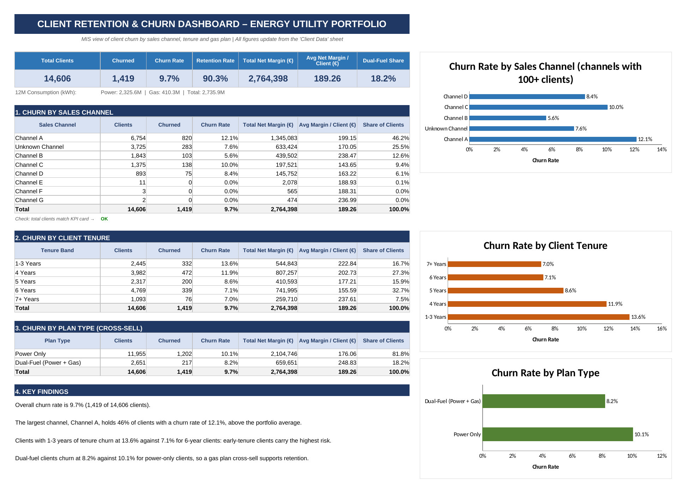

# Client Retention & Churn Dashboard – Energy Utility | Excel

An MIS dashboard on client churn for an energy utility: which sales channels, tenure groups and plan types lose the most clients, and the net margin at stake. Built on **14,606 commercial client accounts**.

## Build
- Helper columns: channel name (VLOOKUP), tenure band (nested IF), gas plan, client status, total consumption
- KPI cards: clients, churn and retention rate, total and average net margin, dual-fuel share
- Segment tables with COUNTIF, COUNTIFS and SUMIF, plus a total-check row
- Bar charts and key findings written as formulas, so they update with the data

## Key findings
- Overall churn **9.7%** (1,419 of 14,606 clients); retention 90.3%; total net margin **€2.76 million**
- Channel A holds 46% of clients and churns at **12.1%**, above the portfolio average
- Clients with 1–3 years of tenure churn at **13.6%**, against 7.1% for 6-year clients
- Dual-fuel clients churn at **8.2%** vs 10.1% for power-only, so a gas cross-sell supports retention

## Files
- `Client_Churn_Dashboard.xlsx`
- `Client_Churn_Dashboard.png`

## Tools
MS Excel (COUNTIFS, SUMIF, VLOOKUP, nested IF, charts)

## Author
**Aditya Kushwaha** · [LinkedIn](https://www.linkedin.com/in/aditya-kushwaha16)
